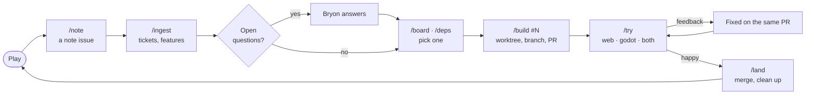

# The dev workflow

How a playtest note becomes a merged change: the stages, which skill runs each, and why it's done this way. The skills live in `.claude/skills/` and lean on three scripts: `scripts/board.mjs` (notes, tickets and the board, all on GitHub Issues), `scripts/try.mjs` (running a branch) and `scripts/land.mjs` (merging and cleaning up).

Think of it as a restaurant: notes are orders scribbled on a pad, tickets are the order slips pinned on the rail, each `/build` is one cook at their own station, `/try` is the tasting, and `/land` sends the plate out and wipes the station.

## The flow

1. **Play and note.** While playing, `/note <text>` opens a GitHub issue labeled `note`, the text word for word. A note can also come straight from GitHub (the phone app, the web, the Note issue template): any open issue that isn't a ticket or feature counts. Nothing else happens, so it's quick and never breaks the flow of play.
2. **Ingest.** `/ingest` turns the waiting notes into tickets (issues labeled `task`) with a size (S, M, L), the likely files, an approach and any open questions; big items become features (labeled `feature`, below). Each note is closed with a comment linking what it became, and each ticket names the notes it came from. The notes from before the move to issues are in `docs/notes-archive.md`.
3. **Answer.** Tickets with open questions (unticked boxes under "Open questions") show as "needs answers". Answer them in one reply (to `/ingest`, `/board` or `/build`), and they become ready.
4. **Pick.** `/board` lists features, then what's ready, needs answers, blocked, in flight and in review. `/deps` draws the dependency tree. Ask for "a quick win" or "the oldest" if nothing in particular calls.
5. **Build.** `/build #N` checks open PRs for overlap, makes a branch (`212-…`) from a fresh `origin/main` in its own worktree, claims the ticket by pushing that branch and commenting on the issue, builds it, runs `npm test`, checks it in the browser on `[::1]:5173` (so the main game's saves aren't touched), updates the docs, and opens a PR that `Closes #N`, with a link to its playable preview.
6. **Try.** `/try #N web|godot|both` starts that worktree's dev server (a port from 5174) or Godot viewer (a bridge port from 7980, scratch saves) in the Terminal panel, and says what to look at. Or play the PR preview on any device. Feedback given afterwards goes on the PR as a checklist and gets fixed on the same branch.
7. **Land.** `/land #N` squash-merges the PR if CI is green (which closes the issue), stops its servers, removes its worktree, deletes its branches, updates main and shows what's ready next. `/land` alone sweeps up anything already merged.

### Features

For items too big for one ticket (a new system, a milestone's worth):

1. `/ingest` makes a **draft** feature with a goal, a design sketch and a rough breakdown (a checklist).
2. `/build #N` on a feature writes or revises its plan: in the issue, or as a doc-only PR with a `docs/PLAN-M*.md` if the design is big. Merge it with `/land`.
3. **Agree** it in `/board` ("agree #109"): each breakdown line becomes a task, a sub-issue of the feature, and the line is ticked with a link to it. Each task's build reads the feature first and treats its design as settled.
4. Optionally, build it **on a branch of its own** (`feature/…`) to test the whole thing before it reaches main: tasks branch from it and their PRs merge into it (`/land` closes their issues, since GitHub only does that on main), `board.mjs sync F-0NN` keeps it current with main, a draft PR into main gives a preview of the feature so far, and it lands last with a merge commit.

## Which skill when

| Skill | Use it when | Example |
| --- | --- | --- |
| `/note` | Something strikes you while playing | `/note glass rooms look too dark at night` |
| `/ingest` | Notes are waiting (the board says so) | `/ingest` |
| `/board` | Choosing what's next, answering questions, agreeing a feature | `/board`, "agree #109" |
| `/deps` | Seeing what's blocked on what | `/deps 14` (keep done tickets on it for 14 days) |
| `/build` | Building a ticket, or planning a feature | `/build 212`, `/build quick win`, `/build #113` |
| `/try` | Playing a branch before it merges, then giving feedback | `/try 212 both`, then "make it brighter" |
| `/land` | A PR is good to merge, or to tidy up after merges | `/land 212`, `/land` |

Ids: tickets and features go by issue number (`#212`, or just `212`). The old ids from before the move to issues (`T-080`, `F-004`) still work as aliases, through `docs/ticket-ids.json` (`t6` is T-006's issue, `f1` is F-001's); open issues dropped the `T-080 · ` prefix from their titles in #331, and closed ones keep it as history.

## Behind the scenes

- **The board is GitHub Issues** on `bdizzz/downtown-mars`: tickets labeled `task`, features labeled `feature` (and `draft` or `agreed`), size and area as labels (`size:M`, `area:sim`), a task's feature as its parent (sub-issues), blockers as GitHub's blocked-by links, and an item's history as its comments. `board.mjs` reads it all in one query and writes through `gh`; nothing about tickets is committed.
- **Status comes from GitHub.** An issue stores only open or closed (done, or not planned for dropped) and the `hibernating` label. A pushed branch for it means in flight, an open PR in review, a merged PR or closed issue done; open questions mean needs answers, and an unfinished blocker (or a draft feature) means blocked. `node scripts/board.mjs menu` works it all out live.
- **A Kanban view** of the same states is the GitHub Project "Downtown Mars board" (`https://github.com/users/bdizzz/projects/1`): every task (dropped ones aside) with its Status set to its derived state. GitHub's own automations only know open and closed, so `board.mjs menu` syncs it each time it runs (only what changed), and `board.mjs project` makes it if it's missing and syncs it. It needs gh's `project` scope (`gh auth refresh -s project`); without it the menu carries on and the Project just isn't updated.
- **A SessionStart hook** (`.claude/hooks/fresh-main.sh`) fetches `origin/main` at the start of every session, and fast-forwards a clean `main` checkout.
- **CI** (`.github/workflows/ci.yml`) type-checks and tests every PR and push to main. **Previews** (`preview.yml`) publish each PR to `https://mars.bryon.site/preview/N/`, rebuilt on every push and removed when the PR closes, with their own saves and the PR number in the tab title (`#N · Downtown Mars`). **Pages** (`pages.yml`) publishes main.
- **Commits** follow Conventional Commits (`fix(render3d): … (#212)`; see CLAUDE.md, "Commit messages"), and PR titles do too.
- **The main checkout** is for playing and taking notes; builds happen in worktrees under `.claude/worktrees/`.

## Why it's done this way

- **Notes are kept word for word**, so nothing is lost in translation; a ticket can always be checked against what was actually said.
- **Notes and tickets are separate steps**, so jotting a note costs nothing while playing, and the thinking (size, files, questions) happens later in one batch.
- **Notes are issues**, so one can be jotted anywhere GitHub runs, the phone included, and every machine sees it.
- **Questions are asked up front**, on the ticket, so a build session doesn't stall halfway or guess at a design call that's Bryon's.
- **Tickets are issues**, not files in the repo, so editing one never conflicts with a branch in flight, and any machine (or a cloud session) can build one with all its context.
- **Status is worked out from GitHub**, so it never needs syncing and two sessions can't write conflicting states.
- **One ticket per branch, worktree and PR**, so several sessions can work at once without stepping on each other, and each change can be reviewed, tried and reverted on its own. The overlap check catches two PRs about to fight over the same system.
- **Features are planned before they're split**, so their tasks share one agreed design and each still lands as a small PR that leaves the game working.
- **Previews and `/try`** let a change be played before it merges, on a phone or the desktop, without disturbing the main game or its saves.
- **Feedback goes on the PR**, so the fix stays with the change it belongs to, and the PR records what was asked for.
- **`/land` does the cleanup**, so worktrees, branches and dev servers don't pile up.
- **Conventional Commits** keep the history readable at a glance.
